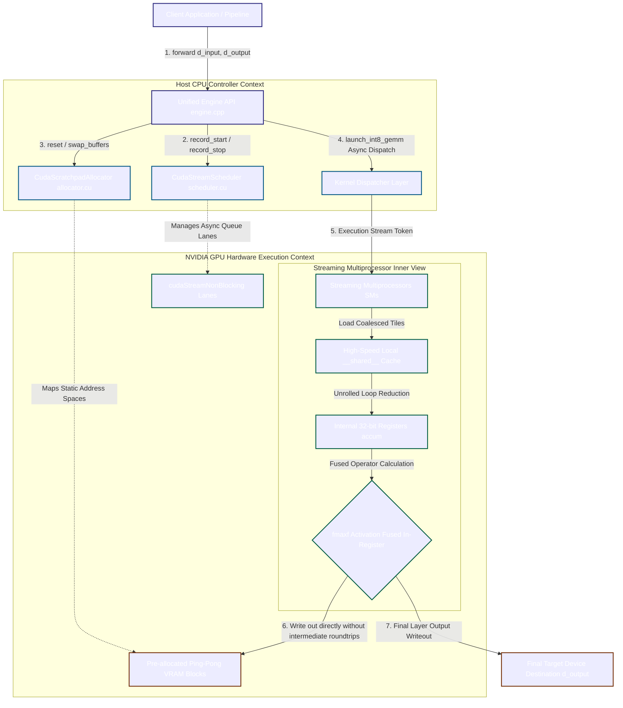

# DOM  Didactic Octo Memory
### didactic-octo-memory
Triton OR **Custom** CUDA Kernel Optimization for LLM Attention and GEMM R&amp;D

## Project Structure Overview
The initial goal of this project was to create a reusable module where the **Custom** kernel definition is separate from the execution logic; however, it was decided to broaden the scope of optimization and implement more comprehensive solutions.

Please read the:
[WIKI](https://github.com/Logic-HQ/didactic-octo-memory/wiki)

[How to Compile and Run ](https://github.com/Logic-HQ/didactic-octo-memory/blob/main/docs/How%20to%20run.md)

Project functionality includes:

- A Static Memory Arena to keep latency flat.
- A Non-blocking Stream Scheduler for low overhead.
- A Shared-memory Tiled INT8 GEMM Kernel for fast hardware math.
- A Main test runner and a CMake build pipeline to tie it all together

## High-Performance Architecture




## Physical Layout & Component Boundary Mapping

```ASCII
+---------------------------------------------------------------------------------------+

|  HOST (CPU) ENVIRONMENT                                                               |
|                                                                                       |
|   [ Client Application ]                                                              |
|            |                                                                          |
|            v                                                                          |
|   +-------------------------------------------------------------------------------+   |
|   |  UNIFIED ENGINE RUNTIME API (engine.cpp)                                      |   |
|   |  - Manages sequential execution pipelines                                      |   |
|   |  - Completely framework-free; native zero host-side overhead                  |   |
|   +-------------------------------------------------------------------------------+   |
|            |                                         |                                |
|            v (Control Tasks)                         v (Memory Addressing)            |
|   +-----------------------------------+     +-------------------------------------+   |
|   | CUDA STREAM SCHEDULER             |     | PING-PONG WORKSPACE ALLOCATOR       |   |
|   | - Holds non-blocking streams      |     | - Pre-allocates Arena VRAM up front |   |
|   | - Native Event Profiling (p99)    |     | - O(1) buffer flip (`swap_buffers`) |   |
|   +-----------------------------------+     +-------------------------------------+   |
+------------|-----------------------------------------|--------------------------------+

             | (Non-blocking async dispatch)           | (Static Base Address Offsets)  
=============|=========================================|=================================
+------------v-----------------------------------------v--------------------------------+

|  DEVICE (GPU) VRAM & CORE EXECUTION LAYER                                            |
|                                                                                       |
|   CUDA Stream Queue Lane (cudaStreamNonBlocking)                                     |
|   [======================================= [INT8 GEMM KERNEL TOKEN] ===> ]            |
|                                                                                       |
|   +-------------------------------------------------------------------------------+   |
|   | GPU STREAMING MULTIPROCESSORS (SM)                                            |   |
|   |                                                                               |   |
|   |  Step A: Global Coalesced Memory Fetch  ===> [ Shared Memory Cache Block ]   |   |
|   |                                                        |                      |   |
|   |  Step B: Loop-Unrolled Register Accumulation <==========+                      |   |
|   |               |                                                               |   |
|   |               v                                                               |   |
|   |  Step C: [ Fused Register ReLU (fmaxf) ]  <-- ZERO latency memory roundtrip   |   |
|   +---------------|---------------------------------------------------------------+   |
|                   |                                                                   |
|                   v (Direct writing back into alternating ping-pong targets)          |
|   +-------------------------------------------------------------------------------+   |
|   | DYNAMIC PING-PONG MEMORY TILES IN HIGH-SPEED VRAM                             |   |
|   |                                                                               |   |
|   |   +-------------------------------+       +-------------------------------+   |   |
|   |   |  BUFFER A (Active Layer N-1)  | <---> |  BUFFER B (Active Layer N)    |   |   |
|   |   +-------------------------------+       +-------------------------------+   |   |
|   +-------------------------------------------------------------------------------+   |
+---------------------------------------------------------------------------------------+
```
